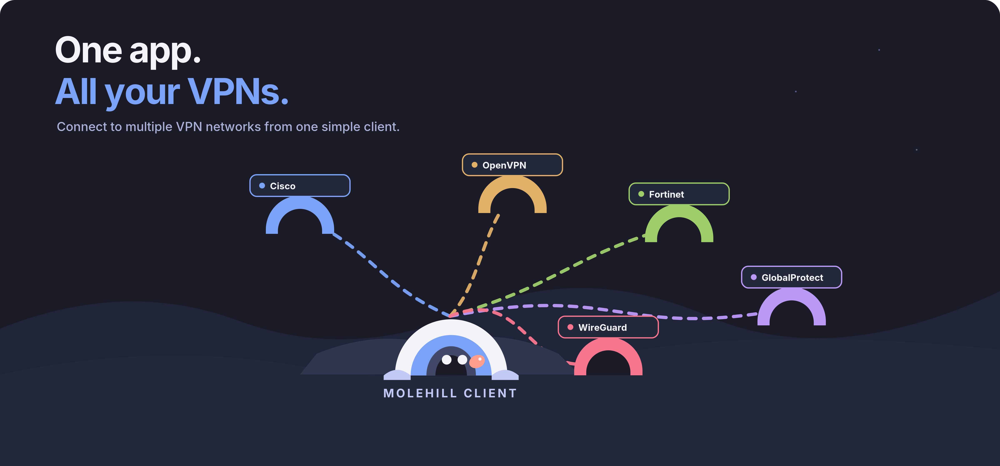
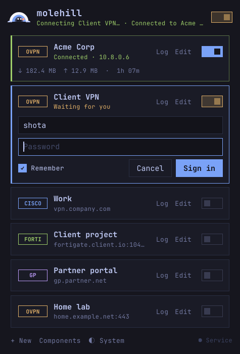
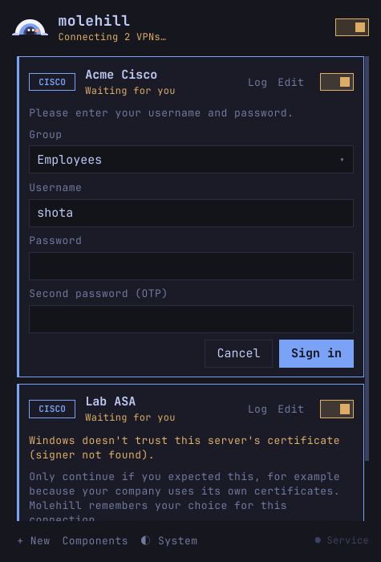
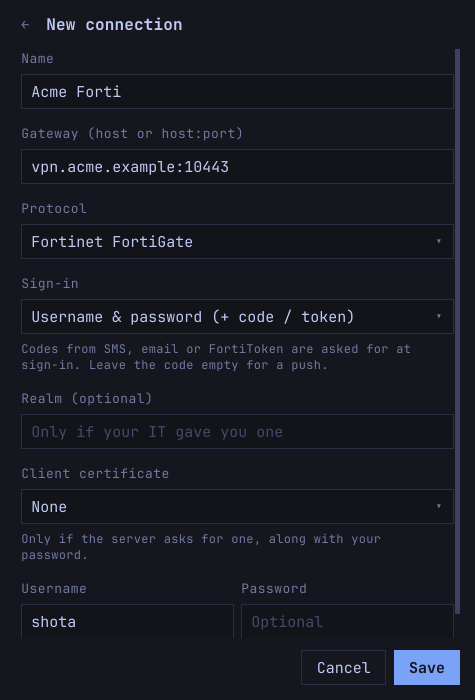

<p align="center">
  
</p>

<p align="center">
  
</p>

<p align="center">
  <a href="https://github.com/giorgobiani/molehill/releases/latest"></a>
  <a href="https://github.com/giorgobiani/molehill/actions/workflows/ci.yml"></a>
  <a href="https://github.com/giorgobiani/molehill/actions/workflows/release.yml"></a>
  <a href="https://github.com/giorgobiani/molehill/releases"></a>
  <a href="LICENSE"></a>
  
  
</p>

<p align="center">
  <b><a href="https://giorgobiani.github.io/molehill/">giorgobiani.github.io/molehill</a></b><br><br>
  <b>One VPN client for Windows and macOS: OpenVPN, Cisco AnyConnect, Fortinet and Palo Alto GlobalProtect.</b><br>
  Several tunnels at once, inline sign-in prompts, saved passwords, browser SSO,<br>
  and the engines it needs installed and kept up to date for you.
</p>

---

Most companies pick one VPN product, and most people end up needing three:
the employer's AnyConnect, a client's FortiGate, a GlobalProtect portal and a
home OpenVPN server, each with its own heavy client, tray icon and update
nag. **Molehill replaces all of them with one small app.**

It is the Windows sibling of
[omarchy-plugin-vpngui](https://github.com/giorgobiani/omarchy-plugin-vpngui)
and shares its look and its sign-in logic: Tokyo Night colours, monospace,
flat and square, nothing in the way.

<p align="center">
  
  
  
</p>

## What it does

- **All your VPNs side by side.** Every connection has its own switch, and
  several can be up at the same time. The header switch is the master switch:
  off disconnects everything, on reconnects the last one.
- **Sign-in where you are.** Whatever the server asks for (username and
  password, a group or gateway to choose, an SMS or authenticator code, a
  FortiToken push, a second password) appears on the connection's card.
  Molehill fills in what it knows and only asks for the rest.
- **Browser SSO (SAML).** Microsoft Entra, Okta, Google and the rest open in
  your default browser and hand the result back to Molehill, for every
  protocol that supports it.
- **Remembered, safely.** Passwords go to Windows Credential Manager (per user,
  DPAPI). A password the server rejects is forgotten; a mistyped 2FA code is
  not mistaken for a wrong password. The group or gateway you pick is
  remembered for next time.
- **Untrusted certificates, handled.** If Windows doesn't trust the server's
  certificate, Molehill shows its fingerprint and asks once; after that the
  connection is pinned to exactly that certificate.
- **Client certificates.** For servers that want a certificate from your
  Windows store along with the password, pick it in the connection's editor;
  Molehill signs in as you, so Windows lets it use your certificate.
- **Keeps itself up to date.** When a new Molehill is released, you get a
  Windows notification and an **Update** button; the installer is downloaded,
  checked against its published SHA-256 and run for you.
- **No prerequisites to hunt for.** OpenVPN and OpenConnect are downloaded,
  verified and installed by Molehill. It checks for new versions twice a day
  and offers the update in the app.
- **Out of the way.** A tray icon that changes colour with the state (blue
  idle, amber connecting, mint for one VPN up, violet for several, coral when
  one failed), a matching dot on the taskbar button, its own tray menu to flip
  tunnels, and closing the window keeps the tunnels up. Live traffic counters,
  connected time and a log per tunnel.
- **Yours to arrange.** Drag connections into the order you want, resize the
  window's height, and it opens where you left it. Tokyo Night dark or
  Tokyo Night Day light, following Windows unless you pick one.

## Supported VPNs

| VPN | Engine | Sign-in |
|-----|--------|---------|
| **OpenVPN** | OpenVPN 2.6 (official MSI, DCO / TAP drivers) | A `.ovpn` file, a profile fetched from **OpenVPN Access Server** with your username and password, or a manual setup (address, port, UDP/TCP, CA, tls-auth / tls-crypt). Username & password, certificates, private key passphrase, static and dynamic challenges (OTP), browser SSO (`WEB_AUTH`, `OPEN_URL`, `CR_TEXT`) |
| **Cisco AnyConnect** / ocserv | OpenConnect | Whatever form the server sends: group list, username, password, second password / OTP, SMS or Microsoft Authenticator codes. Client certificates from the Windows store. Browser SSO. Certificate pinning |
| **Fortinet** FortiGate | OpenConnect | Username & password, realm, 2FA codes (SMS, email, FortiToken) or FortiToken push. Browser SSO the FortiClient way (redirect to `127.0.0.1:8020`). Certificate pinning |
| **Palo Alto GlobalProtect** | OpenConnect | Portal, then gateway (chosen for you when there's one, or the one you picked last time). Username & password, 2FA challenges. Browser SSO in your default browser, like `gpauth`. Certificate pinning |

WireGuard, shown in the artwork, is planned.

## Install

1. Download `molehill-setup-<version>.exe` from
   [Releases](https://github.com/giorgobiani/molehill/releases) and run it.
   It installs the app and the Molehill service.
2. Open Molehill and add a connection with **+ New**. If the engine for that
   protocol is missing, the **Components** page offers to install it.

Requires Windows 10 or 11, 64-bit.

### macOS

1. Download `Molehill-arm64.pkg` (Apple Silicon) or `Molehill-x86_64.pkg`
   (Intel) from [Releases](https://github.com/giorgobiani/molehill/releases).
2. Open it. Molehill isn't signed with a paid Apple Developer ID, so macOS
   blocks it the first time: open **System Settings → Privacy & Security**,
   click **Open Anyway** next to the Molehill message, and confirm with your
   password. Updates don't ask again.
3. The package installs the app, the Molehill service and the OpenVPN and
   OpenConnect engines. Molehill starts in the menu bar.

Requires macOS 15 Sequoia or later. Two prompts to expect:
- After each update, macOS asks once per saved password whether Molehill may
  use it from the Keychain (**Always Allow**). It happens because each update
  carries a new ad-hoc signature.
- Signing in to a server on your local network can bring up the Local Network
  prompt; allow it.

To remove Molehill: `sudo /opt/molehill/uninstall.sh` (your profiles in
`~/Library/Application Support/Molehill` and the Keychain items stay).

## How it works

```
 molehill.exe (you)                       molehill-service.exe (LocalSystem)
 ┌───────────────────────┐   named pipe   ┌───────────────────────────────────────┐
 │ Slint UI + tray       │ ◄────────────► │ tunnel manager                        │
 │ profiles (%APPDATA%)  │   JSON lines   │  ├─ openvpn.exe  ◄─ management iface  │
 │ Credential Manager    │                │  ├─ oc-auth helper (libopenconnect)   │
 │ browser SSO handoff   │                │  │    └─ openconnect.exe + vpnc-script│
 └───────────────────────┘                │  └─ Fortinet / GlobalProtect SSO      │
                                          │ component installer (verified)        │
                                          └───────────────────────────────────────┘
```

- **The app** runs as you. It keeps your profiles in `%APPDATA%\Molehill`, your
  saved passwords in Credential Manager, and opens the browser for SSO.
- **The service** runs as LocalSystem, because creating tunnels, routes and DNS
  needs it. It never shows UI.
  - **OpenVPN** is driven through its management interface, so credentials
    never touch the disk.
  - **OpenConnect protocols** sign in through a small helper process that loads
    `libopenconnect` and turns every server form, certificate question and
    browser step into a prompt in the app. `openconnect.exe` then runs the
    tunnel with the session cookie, pinned to the certificate that was checked.
- **IPC** is the pipe `\\.\pipe\molehill`, local only, open to SYSTEM,
  Administrators and interactive users.

On **macOS** the same pieces run as `Molehill.app` (menu bar, Keychain,
profiles in `~/Library/Application Support/Molehill`) and a root launchd
daemon (`/opt/molehill/bin/molehill-service`) listening on the Unix socket
`/var/run/molehill.sock` (`root:staff`, mode 0660). The engines ship inside
the package in `/opt/molehill/engines`. DNS goes through `scutil`, one set of
keys per tunnel, by Molehill's own hooks: `dns-up`/`dns-down` for OpenVPN
and `vpnc-hook` for OpenConnect, in place of the stock vpnc-script. Client
certificates are `.p12`/`.pfx` files there; OpenConnect can't read the
macOS Keychain.

### Security model

The engines run as SYSTEM, so anything that reaches them is treated as code
with full privileges.

1. When you import an `.ovpn`, the app inlines every file it references (`ca`,
   `cert`, `key`, `tls-auth`, `pkcs12`, …). The service only ever receives one
   self-contained text.
2. The service checks that text again and refuses anything that runs programs,
   loads libraries, writes files or still points at a path (`up`, `down`,
   `plugin`, `script-security`, `log`, `management`, `providers`,
   `tls-crypt-v2-verify`, …), and forces `--script-security 1`.
3. Connection ids are validated before they name any file. The service's data
   folders (`%ProgramData%\Molehill`) are locked to SYSTEM and Administrators,
   and refused if a junction or symlink was planted there. Generated configs
   and management passwords are deleted as soon as they're no longer needed.
4. The OpenVPN installer runs only if its Authenticode signature is valid and
   issued to OpenVPN Inc. OpenConnect publishes no signed Windows installer, so
   Molehill takes the official CI build of each tagged release from
   gitlab.com/openconnect/openconnect over HTTPS.
5. Every engine process is tied to the service with a job object: if the
   service dies, Windows ends the tunnels with it. The sign-in helper is a
   separate process, so a failure in libopenconnect can't take the service down.
6. SSO handoffs check what they accept: the Fortinet callback only on loopback,
   the GlobalProtect `globalprotectcallback:` handler registered only while a
   sign-in waits, and whatever was registered before put back afterwards.
7. Secrets are kept out of logs: cookies, tokens and passwords are dropped or
   redacted from engine output.

On macOS the daemon runs as root and OpenVPN needs `--script-security 2` for
DNS, so the hooks are Molehill's own binary, never a script from a profile.
They read only the variables they expect, accept only addresses, prefix
lengths and plain domain names, and run `scutil`, `route` and `ifconfig` by
absolute path with an empty environment. Profiles are also refused for
`dns-updown` and `client-crresponse` (script hooks) and TAP devices.
launchd ends the engines with the daemon, and at start the daemon removes
DNS settings and routes a crash left behind.

Known limits: on a PC shared by several people at once, one user can see and
disconnect another's tunnels (Molehill is meant for single-user machines).
GlobalProtect HIP reports are not sent yet; many gateways work without them.

## Building

Requirements: Rust (stable, 2024 edition) and the Visual Studio Build Tools
(MSVC). Everything else comes from crates.io.

```powershell
cargo build --release
# installer (needs Inno Setup 6.3+: winget install JRSoftware.InnoSetup)
iscc installer\molehill.iss
```

On macOS: Rust and the Xcode Command Line Tools; the package also needs
Homebrew (for the engines).

```sh
cargo build --release --target aarch64-apple-darwin   # or x86_64-apple-darwin
packaging/macos/bundle-engines.sh dist/engines
packaging/macos/make-app.sh aarch64-apple-darwin dist
packaging/macos/build-pkg.sh aarch64-apple-darwin dist/engines dist
```

### Development loop

```powershell
# elevated terminal: install the service from your build
target\debug\molehill-service.exe install
target\debug\molehill.exe
```

UI work without admin rights: run the service in the foreground against a
scratch directory (tunnels need elevation, everything else works):

```powershell
$env:MOLEHILL_SERVICE_DIR = "$env:TEMP\molehill-svc"
$env:MOLEHILL_USER_DIR    = "$env:TEMP\molehill-user"
Start-Process target\debug\molehill-service.exe run
target\debug\molehill.exe
```

On macOS, the service runs as a root launchd daemon. To use your build:

```sh
cargo build
sudo mkdir -p /opt/molehill/bin /Library/Logs/Molehill
sudo cp target/debug/molehill-service /opt/molehill/bin/
sudo cp packaging/macos/io.github.giorgobiani.molehill.service.plist /Library/LaunchDaemons/
sudo launchctl bootstrap system /Library/LaunchDaemons/io.github.giorgobiani.molehill.service.plist
# after each rebuild:
sudo cp target/debug/molehill-service /opt/molehill/bin/ && sudo launchctl kickstart -k system/io.github.giorgobiani.molehill.service
target/debug/molehill
```

Or, without root (no tunnels), in the foreground against scratch directories:

```sh
export MOLEHILL_SERVICE_DIR=/tmp/molehill-svc MOLEHILL_USER_DIR=/tmp/molehill-user MOLEHILL_SOCKET=/tmp/molehill.sock
target/debug/molehill-service run &
target/debug/molehill
```

```powershell
cargo test                                            # sanitizer, importer, sign-in logic, SSO parsers
cargo run -p molehill --example snapshot -- snapshots # headless screenshots with demo data
```

### Layout

```
crates/
  molehill-core/      shared: IPC protocol, profiles, .ovpn import / sanitize, secrets
  molehill-service/   Windows service: pipe server, tunnels, sign-in helper, SSO, installer
  molehill/           the app: Slint UI (ui/*.slint), tray, IPC client
installer/            Inno Setup script
docs/brand/           logo, icons and artwork (SVG sources, PNG exports, palette)
```

## Roadmap

1. ✅ **OpenVPN**: profiles, every sign-in type, components, tray
2. ✅ **Cisco AnyConnect** through OpenConnect: server forms, groups, 2FA,
   browser SSO, certificate pinning
3. ✅ **Fortinet**: password + 2FA, realm, browser SSO
4. ✅ **GlobalProtect**: portal and gateway, browser SSO in the default browser
5. **Split tunnelling** per connection: only company networks and domains
   through the VPN, internet and DNS on your own connection
6. **WireGuard**
7. GlobalProtect HIP reports; per-user tunnels on shared machines
8. Code-signed releases and a winget manifest
9. ✅ **macOS** (Apple Silicon and Intel): menu bar, Keychain, the same four
   VPNs and sign-ins, `.pkg` with the engines, self-update

## Brand

The mark (layered hill arches, a tunnel, two eyes and a coral nose), the app
icons and the artwork live in [`docs/brand`](docs/brand) as SVG sources with
PNG exports and the palette. The app draws the same mark in code for its
window, tray and installer icons; the tray version changes colour with the
VPN state.

## Contributing

Pull requests into `main`, CI green, squash merge; releases are version tags.
See [CONTRIBUTING.md](CONTRIBUTING.md).

## License

MIT. JetBrains Mono is bundled under the SIL Open Font License
(`crates/molehill/ui/fonts/OFL.txt`).
